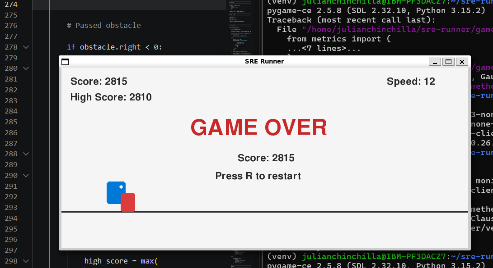
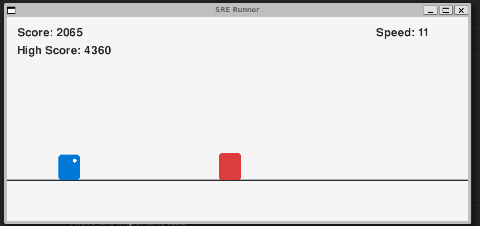
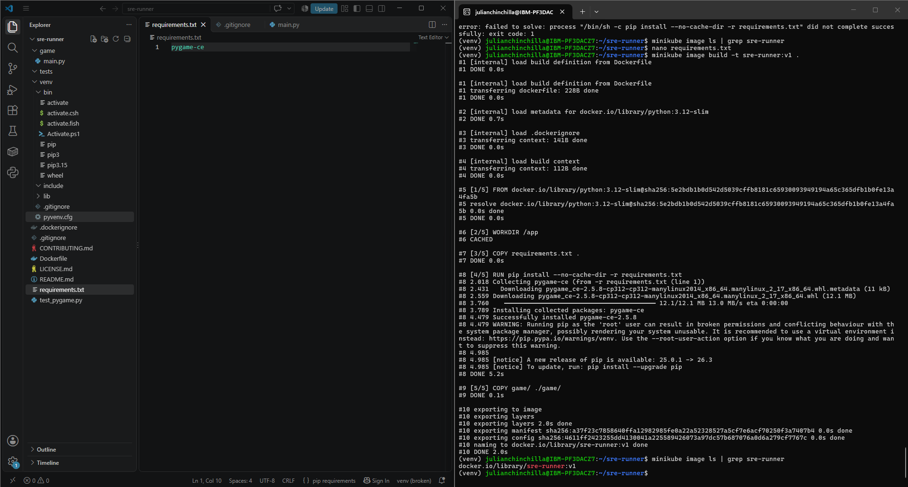
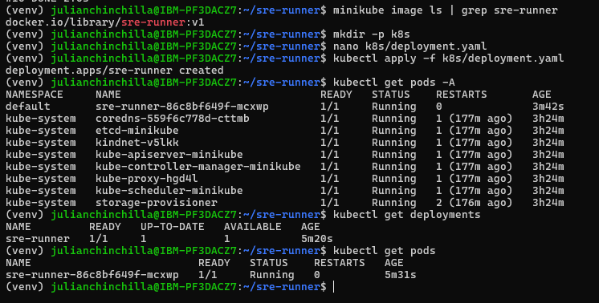
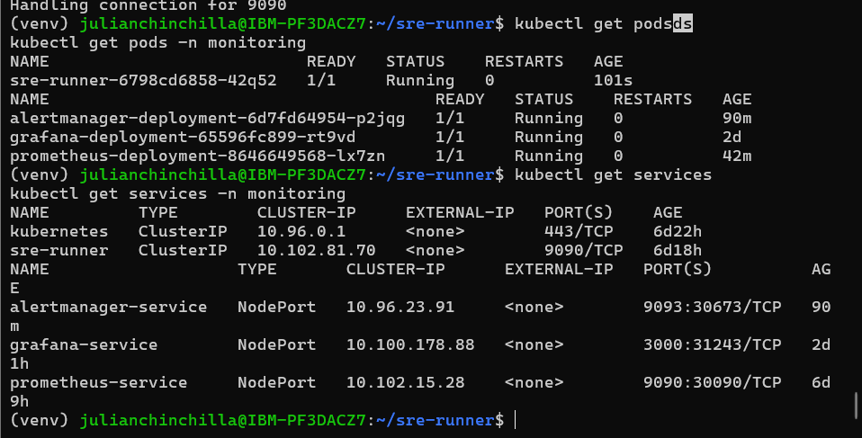
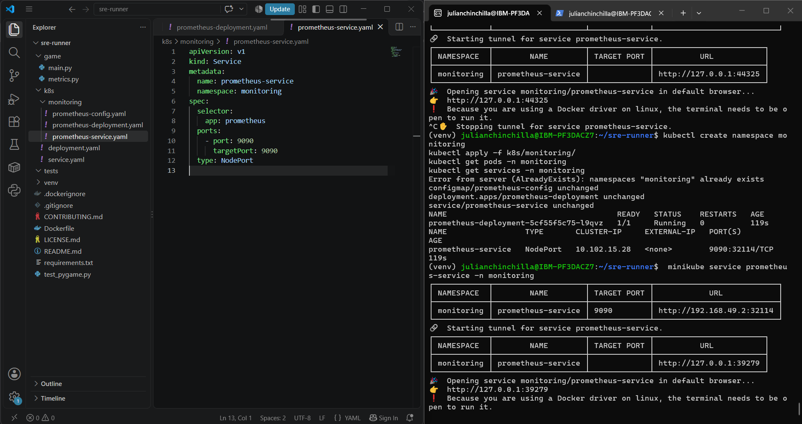
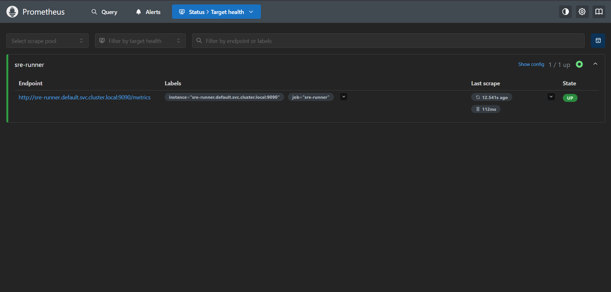
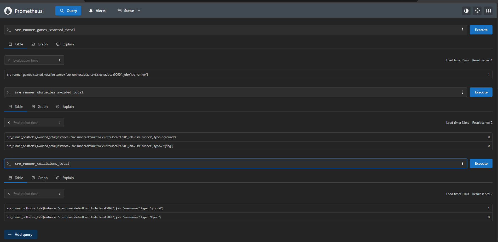
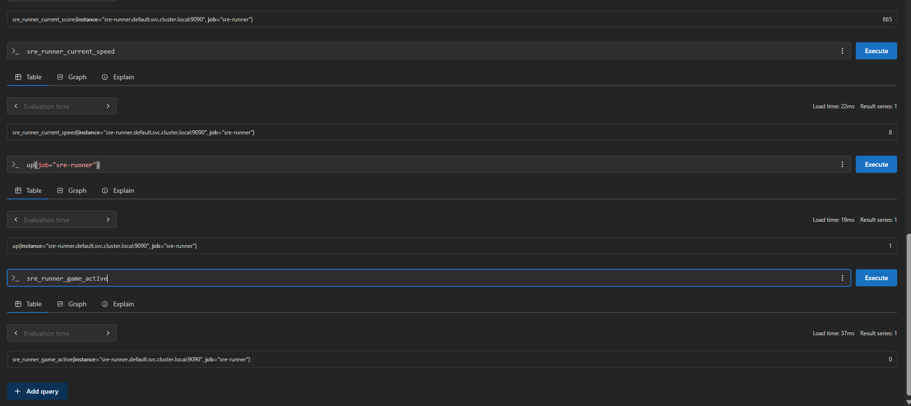
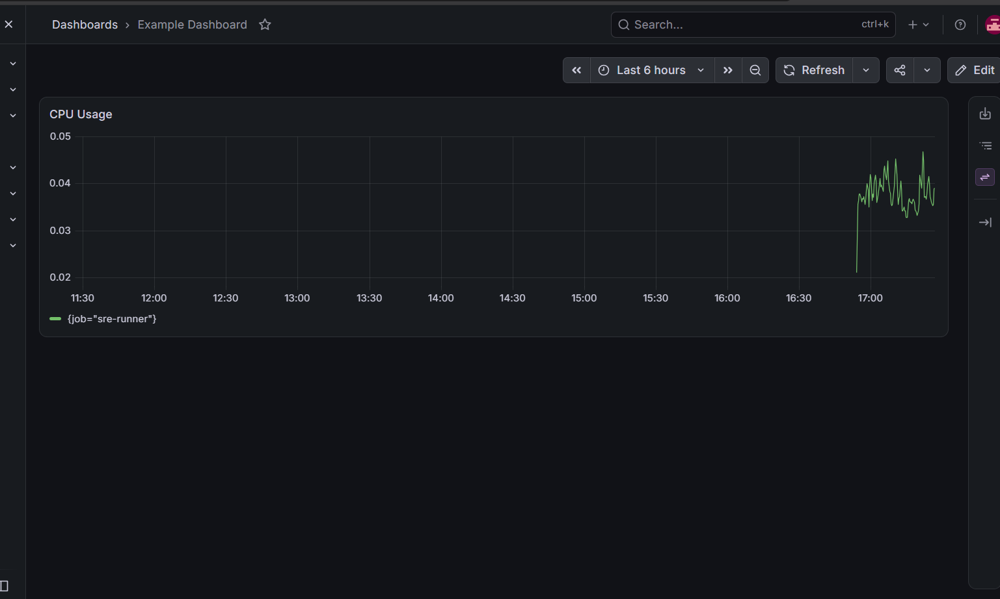

# 🎮 SRE Runner

SRE Runner is a Python/Pygame endless-runner game developed as an SRE Academy final project to demonstrate containerization, Kubernetes deployment, application monitoring, distributed tracing, centralized logging, observability, visualization, and alerting.

The application is containerized with Docker and deployed to a local Kubernetes cluster using Minikube. SRE Runner exposes custom application metrics to Prometheus, emits OpenTelemetry traces and logs, provides container-level telemetry through cAdvisor, visualizes observability data in Grafana and Jaeger, stores centralized logs in Loki, and uses Alertmanager for availability incidents.

The complete project runs locally with **$0 infrastructure cost**.

---

# 🏗️ Architecture

```text
                              MINIKUBE

┌──────────────────────────────────────────────────────────────┐
│                                                              │
│  default namespace                                           │
│                                                              │
│  ┌──────────────────────┐       ┌────────────────────────┐   │
│  │     SRE Runner       │       │        cAdvisor        │   │
│  │                      │       │                        │   │
│  │ Python + Pygame      │       │ Container CPU         │   │
│  │ :9090/metrics        │       │ Memory                │   │
│  │ OTLP traces + logs   │       │ Network I/O           │   │
│  └──────────┬───────────┘       └────────────┬───────────┘   │
│             │                                │               │
│             │                                │               │
│             ▼                                │               │
│  ┌──────────────────────────────┐             │               │
│  │ OpenTelemetry Collector     │             │               │
│  │                              │             │               │
│  │ Traces / Logs / SpanMetrics │             │               │
│  └──────┬────────┬────────┬────┘             │               │
│         │        │        │                  │               │
│         ▼        ▼        ▼                  │               │
│      Jaeger  SpanMetrics  Loki               │               │
│                   │        │                  │               │
│                   ▼        │                  │               │
│               Prometheus ◄─┼──────────────────┘               │
│                   ▲        │                                  │
│                   │        │                                  │
│       SRE Runner metrics   │                                  │
│                   │        │                                  │
│                   └───┐    │                                  │
│                       ▼    ▼                                  │
│                      Grafana                                  │
│                       │                                      │
│                       ▼                                      │
│                  Golden Signals                              │
│                                                              │
│  Prometheus ───────────────────────► Alertmanager            │
│                                                              │
└──────────────────────────────────────────────────────────────┘
```

## Observability Pipelines

```text
Metrics:
SRE Runner ────────────────► Prometheus ──► Grafana
cAdvisor ──────────────────► Prometheus ──► Grafana
OpenTelemetry SpanMetrics ─► Prometheus ──► Grafana

Traces:
SRE Runner ──► OpenTelemetry Collector ──► Jaeger

Logs:
SRE Runner ──► OpenTelemetry Collector ──► Loki ──► Grafana

Alerts:
Prometheus ──► Alertmanager
```

---

# 🛠️ Technology Stack

| Technology | Purpose |
|---|---|
| Python | Application development and instrumentation |
| pygame-ce | Game engine |
| Docker | Application containerization |
| Kubernetes | Container orchestration |
| Minikube | Local Kubernetes cluster |
| Prometheus | Metrics collection, PromQL, and alert evaluation |
| prometheus-client | Custom Python application metrics |
| cAdvisor | Container CPU, memory, and network telemetry |
| OpenTelemetry | Application tracing and logging |
| OpenTelemetry Collector | Telemetry processing and routing |
| SpanMetrics | Trace-to-metric conversion |
| Jaeger | Distributed trace visualization |
| Loki | Centralized log storage and LogQL |
| Grafana | Metrics and logs visualization |
| Alertmanager | Alert management |
| Git | Version control |
| GitHub | Source repository |

---

# 🎮 Application

SRE Runner is an endless-runner game featuring:

- Ground obstacles
- Flying obstacles
- Jump mechanics
- Increasing game speed
- Score tracking
- High-score tracking
- Collision detection
- Custom Prometheus metrics
- OpenTelemetry tracing
- Structured application logging

Ground obstacles are available from the beginning of the game. Flying obstacles are introduced as the score increases.

## Gameplay





---

# 📂 Repository Structure

```text
sre-runner/
├── game/
│   ├── main.py
│   ├── metrics.py
│   └── telemetry.py
│
├── k8s/
│   ├── deployment.yaml
│   ├── service.yaml
│   │
│   ├── monitoring/
│   │   ├── alertmanager.yaml
│   │   ├── cadvisor.yaml
│   │   ├── grafana.yaml
│   │   ├── prometheus-config.yaml
│   │   ├── prometheus-deployment.yaml
│   │   ├── prometheus-rbac-cluster.yaml
│   │   ├── prometheus-rules.yaml
│   │   └── prometheus-service.yaml
│   │
│   └── observability/
│       ├── jaeger.yaml
│       ├── loki.yaml
│       └── otel-collector.yaml
│
├── docs/
│   └── images/
│
├── Dockerfile
├── requirements.txt
├── .dockerignore
├── .gitignore
├── CONTRIBUTING.md
├── LICENSE.md
└── README.md
```

---

# 🚀 Running the Project

## Prerequisites

The project requires:

- Docker
- Minikube
- kubectl
- Python 3
- Git

Create the local Python environment:

```bash
python3 -m venv venv
source venv/bin/activate
pip install -r requirements.txt
```

---

## ▶️ Run SRE Runner Locally

```bash
python game/main.py
```

Controls:

```text
SPACE    Jump
R        Restart after Game Over
```

> The Kubernetes OpenTelemetry Collector DNS address is only available inside the cluster. Local gameplay may require a locally reachable OTLP endpoint if telemetry export is enabled.

---

# 🐳 Containerization

The application is packaged with Docker.

Build the application directly into Minikube:

```bash
minikube image build -t sre-runner:v5 .
```

Verify:

```bash
minikube image ls | grep sre-runner
```

Using Minikube's local image store removes the need for Docker Hub or another external registry.

## Docker Image Verification



---

# ☸️ Kubernetes Deployment

Start Minikube:

```bash
minikube start
```

Deploy SRE Runner:

```bash
kubectl apply -f k8s/deployment.yaml
kubectl apply -f k8s/service.yaml
```

Verify:

```bash
kubectl get pods
kubectl get services
```

SRE Runner runs in the `default` namespace.

The application metrics endpoint is:

```text
http://sre-runner:9090/metrics
```

From another Kubernetes namespace:

```text
http://sre-runner.default.svc.cluster.local:9090/metrics
```

## Initial Kubernetes Deployment



## Complete Kubernetes Environment

The final Minikube environment runs SRE Runner alongside the monitoring and observability stack.



---

# 📊 Application Metrics

SRE Runner uses `prometheus-client` to expose application-specific metrics.

## Games Started

```promql
sre_runner_games_started_total
```

## Game Active

```promql
sre_runner_game_active
```

Values:

```text
1 = game active
0 = game over
```

## Current Score

```promql
sre_runner_current_score
```

## Current Speed

```promql
sre_runner_current_speed
```

## Obstacles Avoided

```promql
sre_runner_obstacles_avoided_total{type="ground"}
sre_runner_obstacles_avoided_total{type="flying"}
```

Both:

```promql
sre_runner_obstacles_avoided_total
```

## Collisions

```promql
sre_runner_collisions_total{type="ground"}
sre_runner_collisions_total{type="flying"}
```

Both:

```promql
sre_runner_collisions_total
```

---

# 🔥 Prometheus

Prometheus runs in the Kubernetes `monitoring` namespace.

Deploy the monitoring stack:

```bash
kubectl apply -f k8s/monitoring/
```

Verify:

```bash
kubectl get pods -n monitoring
```

Access Prometheus:

```bash
kubectl port-forward -n monitoring service/prometheus-service 9090:9090
```

Open:

```text
http://localhost:9090
```

Prometheus collects telemetry from:

```text
sre-runner
cadvisor
otel-collector
```

These provide:

- Native SRE Runner metrics
- Container/resource metrics
- Trace-derived metrics

## Prometheus Running



## Prometheus Target Health

Prometheus successfully discovers and scrapes SRE Runner.



## Prometheus Custom Metrics





---

# ❤️ Application Availability

Prometheus automatically exposes:

```promql
up{job="sre-runner"}
```

Values:

```text
1 = scrape successful
0 = scrape unsuccessful
```

The same metric drives the SRE Runner availability alert.



---

# 📦 cAdvisor

cAdvisor provides container and Kubernetes workload telemetry.

Important metrics include:

```promql
container_cpu_usage_seconds_total
container_memory_usage_bytes
container_network_receive_bytes_total
container_network_transmit_bytes_total
```

The local Minikube/containerd environment primarily exposes Kubernetes workloads through cgroup identifiers in the `id` label.

Golden Signals therefore selects Kubernetes workload cgroups with:

```promql
id=~"/kubepods.*"
```

Example CPU query:

```promql
sum(
  rate(
    container_cpu_usage_seconds_total{
      job="cadvisor",
      id=~"/kubepods.*"
    }[5m]
  )
)
```

---

# 🔭 OpenTelemetry

SRE Runner uses the OpenTelemetry Python SDK for application tracing and structured logging.

Telemetry is exported over OTLP/gRPC to:

```text
otel-collector.opentelemetry.svc.cluster.local:4317
```

The OpenTelemetry Collector processes:

```text
Traces
Logs
Span-derived metrics
```

## Instrumented Operations

```text
game.start
game.restart
player.jump
obstacle.spawn
obstacle.avoided
collision
```

Useful span attributes include:

```text
game.score
game.speed
game.high_score
obstacle.type
```

Collision spans are deliberately marked:

```text
STATUS_CODE_ERROR
```

This allows collisions to appear as trace-derivedRE_Runner_Jager_Metrics.png

---

# 📐 Trace-Derived Metrics

The OpenTelemetry `spanmetrics` connector converts traces into Prometheus metrics.

Examples:

```promql
otel_collector_span_metrics_calls_total
otel_collector_span_metrics_duration_milliseconds_count
otel_collector_span_metrics_duration_milliseconds_sum
```

Trace errors:

```promql
otel_collector_span_metrics_calls_total{
  service_name="sre-runner",
  status_code="STATUS_CODE_ERROR"
}
```

Average span duration:

```promql
sum by (span_name) (
  otel_collector_span_metrics_duration_milliseconds_sum{
    service_name="sre-runner"
  }
)
/
sum by (span_name) (
  otel_collector_span_metrics_duration_milliseconds_count{
    service_name="sre-runner"
  }
)
```

This produces operation latency for spans including:

```text
collision
game.start
obstacle.spawn
```

---

# 📝 Centralized Logging with Loki

SRE Runner application logs follow this pipeline:

```text
SRE Runner
    ↓
OpenTelemetry Collector
    ↓
Loki
    ↓
Grafana
```

Application log events include:

```text
SRE Runner game started
Obstacle spawned
Obstacle avoided
Player jumped
Collision detected
Game over
Game restarted
```

Loki identifies the application through:

```text
service_name="sre-runner"
```

## LogQL Queries

All SRE Runner logs:

```logql
{service_name="sre-runner"}
```

Collision logs:

```logql
{service_name="sre-runner"} |= "Collision"
```

Collision count over five minutes:

```logql
sum(
  count_over_time(
    {service_name="sre-runner"} |= "Collision" [5m]
  )
)
```

## Loki Evidence

docs/images/SRE_Runner_Loki_Runing.png

---

# 📈 Grafana

Grafana runs in the Kubernetes `monitoring` namespace.

Access Grafana:

```bash
kubectl port-forward -n monitoring service/grafana-service 3000:3000
```

Open:

```text
http://localhost:3000
```

Default local-lab credentials:

```text
Username: admin
Password: admin
```

Grafana automatically provisions:

```text
Prometheus
Loki
```

Internal Prometheus URL:

```text
http://prometheus-service.monitoring.svc.cluster.local:9090
```

Internal Loki URL:

```text
http://loki.opentelemetry.svc.cluster.local:3100
```

---

## Grafana Dashboards

Three dashboards are provisioned through Infrastructure as Code.

### Example Dashboard

Contains the CPU Usage example used during the SRE Academy exercises.

### SRE Runner Dashboard

Application-specific visualization covering:

- Game Active
- Current Score
- Current Speed
- Games Started
- Ground/flying collisions
- Ground/flying obstacles avoided

docs/images/SRE_Runner_Grafana_Dash_1.png

---

# ⭐ SRE Runner Golden Signals

The final Grafana dashboard implements the four SRE Golden Signals using SRE Runner metrics, OpenTelemetry SpanMetrics, cAdvisor, Prometheus, and Loki.

docs/images/SRE_Runner_Golden_Signals.png

---

## 1. Latency

Latency is derived from OpenTelemetry span duration:

```promql
sum by (span_name) (
  otel_collector_span_metrics_duration_milliseconds_sum{
    service_name="sre-runner"
  }
)
/
sum by (span_name) (
  otel_collector_span_metrics_duration_milliseconds_count{
    service_name="sre-runner"
  }
)
```

This represents average execution duration for instrumented SRE Runner operations.

---

## 2. Traffic

Trace-derived application operations:

```promql
sum by (span_name) (
  otel_collector_span_metrics_calls_total{
    service_name="sre-runner"
  }
)
```

Kubernetes network receive:

```promql
sum(
  rate(
    container_network_receive_bytes_total{
      job="cadvisor",
      id=~"/kubepods.*"
    }[5m]
  )
)
```

Kubernetes network transmit:

```promql
sum(
  rate(
    container_network_transmit_bytes_total{
      job="cadvisor",
      id=~"/kubepods.*"
    }[5m]
  )
)
```

---

## 3. Errors

Errors are correlated across metrics, traces, and logs.

### Trace Errors

```promql
sum(
  otel_collector_span_metrics_calls_total{
    service_name="sre-runner",
    status_code="STATUS_CODE_ERROR"
  }
)
```

### Application Collisions

```promql
sum(sre_runner_collisions_total)
```

### Loki Error Events

```logql
{service_name="sre-runner"} |= "Collision"
```

Together these provide visibility across:

```text
Application metrics
OpenTelemetry traces
Trace-derived metrics
Centralized application logs
```

---

## 4. Saturation

Kubernetes CPU:

```promql
sum(
  rate(
    container_cpu_usage_seconds_total{
      job="cadvisor",
      id=~"/kubepods.*"
    }[5m]
  )
)
```

Kubernetes memory:

```promql
sum(
  container_memory_usage_bytes{
    job="cadvisor",
    id=~"/kubepods.*"
  }
)
```

These metrics represent resource saturation across Kubernetes workload cgroups running inside Minikube.

---

# 🚨 Alertmanager

Alertmanager receives alerts generated by Prometheus.

Access:

```bash
kubectl port-forward -n monitoring service/alertmanager-service 9093:9093
```

Open:

```text
http://localhost:9093
```

## SRE Runner Availability Alert

Prometheus evaluates:

```promql
up{job="sre-runner"} == 0
```

The condition must remain active for:

```text
1 minute
```

before firing.

Alert:

```text
SRERunnerDown
```

Severity:

```text
critical
```

Description:

```text
Prometheus has been unable to scrape SRE Runner for more than 1 minute.
```

---

# 🧪 Incident Simulation

Application failure is safely simulated by scaling SRE Runner to zero replicas:

```bash
kubectl scale deployment sre-runner --replicas=0
```

Incident lifecycle:

```text
SRE Runner unavailable
        ↓
Prometheus scrape fails
        ↓
up{job="sre-runner"} = 0
        ↓
SRERunnerDown PENDING
        ↓
1 minute
        ↓
SRERunnerDown FIRING
        ↓
Alertmanager receives incident
```

Restore the application:

```bash
kubectl scale deployment sre-runner --replicas=1
```

Recovery:

```text
SRE Runner Running
        ↓
Prometheus scraping resumes
        ↓
up{job="sre-runner"} = 1
        ↓
Alert resolves
```

---

# 🔍 Alertmanager API Verification

Active alerts can be verified through:

```bash
curl -s http://localhost:9093/api/v2/alerts
```

With `jq`:

```bash
curl -s http://localhost:9093/api/v2/alerts | jq
```

During an incident this exposes:

```text
alertname = SRERunnerDown
severity  = critical
state     = active
```

---

# 🛑 Starting and Stopping the Environment

Stop Minikube without destroying the environment:

```bash
minikube stop
```

Restart:

```bash
minikube start
```

Verify:

```bash
kubectl get pods -A
```

The major workloads are:

```text
default
├── sre-runner
└── cadvisor

monitoring
├── prometheus
├── grafana
└── alertmanager

opentelemetry
├── otel-collector
├── jaeger
└── loki
```

> Do not run `minikube delete` unless the intention is to destroy the local Kubernetes cluster.

---

# 📸 Project Evidence

All project screenshots are stored under:

```text
docs/images/
```

Current evidence:

```text
docs/images/
├── SRE_Runner_Game_1.png
├── SRE_Runner_Game_2.png
├── SRE_Runner_Golden_Signals.png
├── SRE_Runner_Grafana_Dash_1.png
├── SRE_Runner_Grafana_Uptime.png
├── SRE_Runner_Jager_Metrics.png
├── SRE_Runner_Kubernetes_Full_Running.png
├── SRE_Runner_Loki_Runing.png
├── SRE_Runner_Prometheus_Metrics_1.png
├── SRE_Runner_Prometheus_Metrics_2.png
├── SRE_Runner_Prometheus_Target.png
├── SRE_Runner_Promethus_Runing.png
├── SRE_Runner_initial_docker_confirm.png
└── SRE_Runner_kubernetes_initial_deploy.png
```

This evidence demonstrates:

- Local SRE Runner gameplay
- Docker image creation
- Initial Kubernetes deployment
- Complete Kubernetes environment
- Prometheus deployment
- Prometheus target health
- Custom application metrics
- Grafana application visualization
- Application uptime monitoring
- OpenTelemetry/Jaeger distributed tracing
- Loki centralized logging
- Golden Signals observability

---

# 🔧 Useful Commands

## SRE Runner

```bash
kubectl get pods
kubectl get services
kubectl logs -l app=sre-runner
```

## Full Cluster

```bash
kubectl get pods -A
kubectl get services -A
```

## Monitoring

```bash
kubectl get pods -n monitoring
kubectl get services -n monitoring
```

## Observability

```bash
kubectl get pods -n opentelemetry
kubectl get services -n opentelemetry
```

## Prometheus

```bash
kubectl logs -l app=prometheus -n monitoring
kubectl port-forward -n monitoring service/prometheus-service 9090:9090
```

## Grafana

```bash
kubectl logs -l app=grafana -n monitoring
kubectl port-forward -n monitoring service/grafana-service 3000:3000
```

## Alertmanager

```bash
kubectl logs -l app=alertmanager -n monitoring
kubectl port-forward -n monitoring service/alertmanager-service 9093:9093
```

## Jaeger

```bash
kubectl port-forward -n opentelemetry service/jaeger-service 16686:16686
```

## Loki

```bash
kubectl port-forward -n opentelemetry service/loki 3100:3100
```

---

# 💰 Cost

This project is designed to run at **$0 infrastructure cost**.

Minikube is used instead of managed Kubernetes services such as AKS, GKE, or EKS, allowing the Kubernetes and observability stack to run entirely on local infrastructure.

No paid hosted monitoring or observability platform is required.

---

# 🛡️ Reliability and Observability Practices

The project demonstrates:

- Application-level instrumentation
- Infrastructure-level telemetry
- Custom Prometheus metrics
- PromQL
- LogQL
- Distributed tracing
- Centralized logging
- Trace-derived metrics
- Golden Signals monitoring
- Kubernetes service discovery
- Cross-namespace Kubernetes communication
- Infrastructure-as-Code dashboards
- Infrastructure-as-Code alert rules
- Application availability monitoring
- Alert routing
- Failure simulation
- Recovery validation
- Git-based configuration management

---

# 🔮 Future Improvements

Potential improvements include:

- Persistent Prometheus storage
- Persistent Grafana storage
- Persistent Loki storage
- Persistent Jaeger trace storage
- Alertmanager notifications through Microsoft Teams, Slack, or email
- Kubernetes readiness and liveness probes
- CPU and memory resource requests/limits
- Additional SLOs and SLIs
- Error-budget monitoring
- Helm packaging
- Terraform-based infrastructure
- Argo CD / GitOps
- GitHub Actions CI/CD
- Automated container builds
- Automated Kubernetes manifest validation
- Multi-replica SRE Runner deployment
- Web-based game client for interactive Kubernetes gameplay
- Optional production deployment to AKS, GKE, or EKS

---

# 🤝 Contributing

See [CONTRIBUTING.md](CONTRIBUTING.md) for contribution guidelines.

---

# 📄 License

See [LICENSE.md](LICENSE.md) for license information.